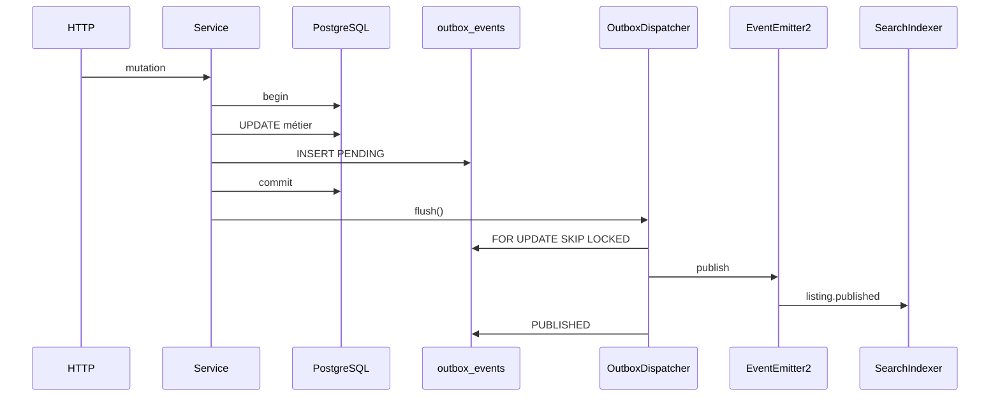

# Architecture événementielle

**Date :** 2026-10-26 · **ADR :** [0014](../decisions/0014-event-driven-outbox.md)

## Principes

1. PostgreSQL est la source de vérité des données métier.
2. Un événement décrit un **fait déjà survenu**, jamais une intention.
3. Communication synchrone pour la réponse HTTP ; événements pour les traitements secondaires.
4. Livraison **at-least-once**. Exactement-une-fois n’est pas garanti de bout en bout.
5. Monolithe modulaire NestJS : pas de nouveau microservice, pas de Kafka.

## Composants réels

| Composant                  | Rôle                                            |
| -------------------------- | ----------------------------------------------- |
| `OutboxService.append(tx)` | Écriture atomique avec la mutation              |
| `OutboxDispatcher`         | Publication hors transaction, SKIP LOCKED       |
| `DomainEventPublisher`     | Bus en processus (listeners existants)          |
| `InboxService`             | Déduplication durable (indexeur recherche)      |
| Files métier dédiées       | Notifications, partenaires, médias (inchangées) |

## Transport

**Retenu :** PostgreSQL + dispatcher in-process + EventEmitter2.

**Écarté pour l’instant :** Kafka, Redpanda, file BullMQ générique. BullMQ reste limité à `system.ping`.

Le domaine ne dépend pas de Redis ni d’un broker. Une abstraction `OutboxService` / `DomainEvent` permettrait un relais BullMQ ou Kafka **sans changer les producteurs**.

## Limites

- Les listeners `suppressErrors: true` ne font pas échouer la publication Outbox. Un index en retard se rattrape par `search:reindex` et le poller d’expiration.
- Les événements hors outbox (login, `notification.deliveries_queued`) peuvent encore être perdus en cas de crash : ce n’est pas une incohérence métier.
- Timestamps `occurred_at` + `id` d’outbox : pas une garantie d’ordre global. L’indexeur relit l’état courant.

Voir aussi : [catalogue](./event-catalog.md), [outbox](./transactional-outbox-pattern.md), [feuille de route](./event-driven-evolution-roadmap.md).
