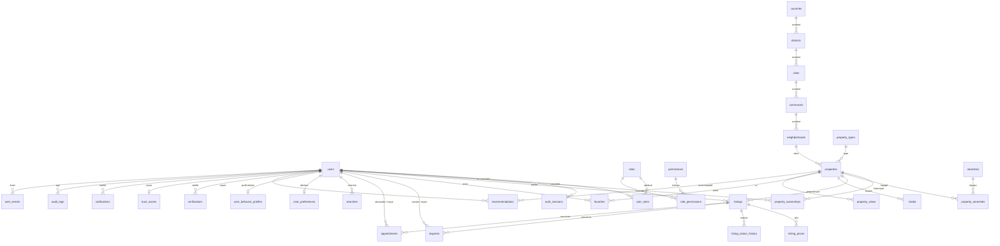
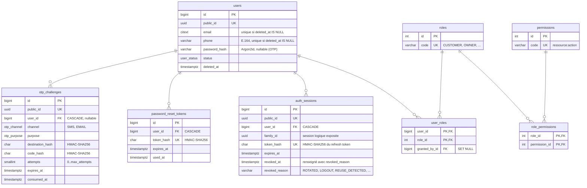
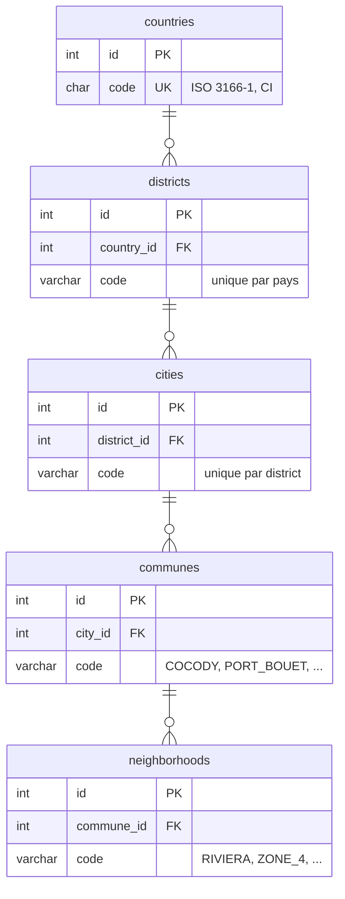
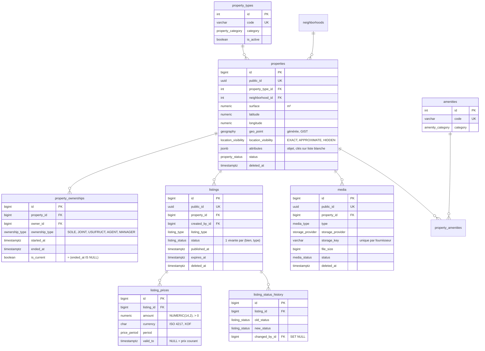
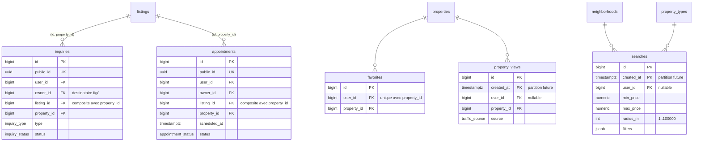

# Diagramme entité-association

Modèle physique v1. Les colonnes `created_at`, `updated_at` et `deleted_at` sont omises sauf quand elles portent une règle. Détails et contraintes : [database.md](./database.md).

## Vue d'ensemble

## Identity

## Location

## Property, Listing, Media

## Interaction et Search

## Recommendation, Trust, Communication, Audit, Events

```mermaid
erDiagram
    user_preferences {
        bigint user_id PK, FK
        numeric min_budget
        numeric max_budget
        listing_type_array preferred_listing_types
    }
    user_preferred_communes {
        bigint user_id PK, FK
        int commune_id PK, FK
    }
    user_behavior_profiles {
        bigint user_id PK, FK
        jsonb preferred_locations
        float price_sensitivity "0..1"
        varchar model_version
    }
    recommendations {
        bigint id PK
        bigint user_id FK
        bigint property_id FK
        float score "0..1"
        varchar algorithm_version
        timestamptz expires_at
    }
    verifications {
        bigint id PK
        bigint user_id FK
        bigint property_id FK "requis pour PROPERTY_OWNERSHIP"
        verification_type type
        verification_status status
        varchar document_reference "clé S3/R2"
        bigint verified_by_id FK "SET NULL"
    }
    trust_scores {
        bigint id PK
        bigint user_id UK, FK
        numeric score "0..100"
        varchar algorithm_version
    }
    notifications {
        bigint id PK
        bigint user_id FK
        notification_type type
        timestamptz read_at "index des non lues"
    }
    audit_logs {
        bigint id PK
        timestamptz created_at PK "append-only"
        bigint actor_id FK "SET NULL"
        varchar entity_type
        varchar entity_id "sans clé étrangère"
        inet ip_address
        varchar request_id
    }
    user_events {
        bigint id PK
        timestamptz created_at PK "partition future"
        bigint user_id FK "SET NULL"
        user_event_type event_type
        timestamptz occurred_at "horloge client"
        jsonb metadata
    }
    user_preferences ||--o{ user_preferred_communes : ""
    communes ||--o{ user_preferred_communes : ""
```

Les tables `user_preferred_property_types`, `user_preferred_amenities` et `user_preferred_neighborhoods` suivent le même modèle que `user_preferred_communes`.
