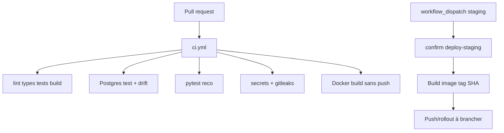

# Gouvernance des déploiements

Complète [ci-cd.md](./ci-cd.md), [deployment-strategy.md](./deployment-strategy.md), [runbooks/deployment-and-rollback.md](./runbooks/deployment-and-rollback.md).

## État réel

- PR : `permissions: contents: read`, pas de secrets prod.
- Staging : confirmation textuelle `deploy-staging`, `environment: staging`, **push registry non configuré**.
- Production : **pas de workflow**. Ne pas auto-déployer.

## Artefacts

Cible : une image par SHA (`GITHUB_SHA`), **même** artefact staging → prod. Aujourd’hui le job docker CI tague `mon-appart-api:ci` sans registry.

Métadonnées autorisées : commit, date de build, `APP_VERSION` / `GIT_SHA` (health). Pas de secrets dans les labels.

## Staging (quand l’hébergeur existe)

1. CI verte.
2. `migrate deploy` (job one-shot).
3. Rollout API / workers / web.
4. `pnpm smoke:health` + parcours login/recherche.
5. Logs / ready.

## Production (cible)

Approbation Environment GitHub. Même artefact. Surveillance 5xx / ready / outbox. Rollback = redéployer le SHA précédent **si** le schéma reste compatible.

## Rollback

| Type          | Réaliste ?                      | Notes                                         |
| ------------- | ------------------------------- | --------------------------------------------- |
| Applicatif    | Oui si expand/contract          | Image précédente                              |
| Configuration | Oui                             | Réinjecter l’env, redémarrer                  |
| Migration     | **Non** par down                | Forward-fix ou restauration backup **testée** |
| Données       | Restauration PITR               | Perte depuis le snapshot ; décision humaine   |
| Événements    | Rejeu outbox / `search:reindex` | At-least-once                                 |

Critère : incident code sans drift schéma → rollback app. Schéma incompatible → ne pas reculer l’image seule.
