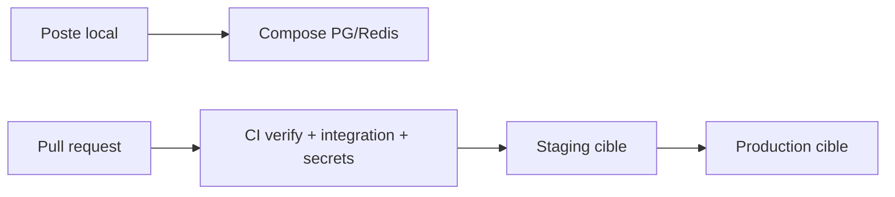

# Stratégie multi-environnements

Complète [environments.md](./environments.md). Les URL et identifiants d’hébergement réels ne sont **pas** dans le dépôt.

## Faits

| Environnement     | Présent aujourd’hui  | Comment                                                                                                             |
| ----------------- | -------------------- | ------------------------------------------------------------------------------------------------------------------- |
| Local             | **Oui**              | Compose `infrastructure/docker/compose.yaml` (Postgres 5433, Redis 6380, pgAdmin 127.0.0.1:5050)                    |
| Tests automatisés | **Oui**              | `TEST_DATABASE_URL` `*_test`, job CI `integration`                                                                  |
| CI                | **Oui**              | `.github/workflows/ci.yml`                                                                                          |
| Staging           | **Cible documentée** | Environment GitHub `staging` ; workflow `deploy-staging.yml` = garde manuelle + build, **push/rollout non branché** |
| Production        | **Cible documentée** | Aucun workflow de production dans le dépôt                                                                          |
| Preview PR        | **Non déployé**      | Pas de Vercel/preview GitHub dans ce repo                                                                           |

`APP_ENV` : `local` \| `test` \| `development` \| `staging` \| `production` (`packages/config`).

## Matrice

|             | Local                       | Test / CI                  | Staging (cible)                                 | Production (cible)                            |
| ----------- | --------------------------- | -------------------------- | ----------------------------------------------- | --------------------------------------------- |
| Objectif    | Développer                  | Preuves reproductibles     | Valider migrations et smoke                     | Trafic réel                                   |
| Données     | Seed `development` (fictif) | Référentiels `reference`   | Référentiels ; pas de copie prod non anonymisée | Réelles                                       |
| PostgreSQL  | `mon_appart` Compose        | `mon_appart_test`          | Instance **dédiée**                             | Instance **dédiée**                           |
| Redis       | Compose `:6380`             | CI ou mock mémoire         | Managé dédié                                    | Managé dédié                                  |
| OpenSearch  | Optionnel, défaut Postgres  | Postgres                   | Sandbox dédié si activé                         | Dédié si activé                               |
| Médias      | Disque local                | Local / fixtures           | Bucket **non prod**                             | Bucket prod                                   |
| Paiement    | `none` ou `mock`            | `mock` autorisé            | **mock interdit**                               | **mock interdit**                             |
| Email / SMS | `none`                      | `none`                     | Sandbox fournisseur                             | Compte prod                                   |
| IA          | `rules` ; OpenAI optionnel  | `rules`                    | Clé non prod                                    | Clé prod                                      |
| Secrets     | `.env` local (gitignoré)    | Placeholders CI            | GitHub Environment `staging`                    | GitHub Environment `production`               |
| Accès       | Développeurs machine        | Runners GitHub             | Équipe + reviewers Environment                  | Accès restreint                               |
| Déploiement | `pnpm dev`                  | N/A                        | Manuel `workflow_dispatch`                      | Approbation + même artefact                   |
| Sauvegarde  | Volumes Docker locaux       | Aucune                     | Snapshot avant migration                        | PITR / snapshots (à activer chez l’hébergeur) |
| Nettoyage   | `pnpm docker:down`          | Éphémère CI                | Rétention courte                                | Rétention métier                              |
| Sécurité    | Loopback pgAdmin            | Pas de secrets prod sur PR | HTTPS, mock paiement refusé                     | Idem + rotation                               |

## Séparation

**Physique (recommandé dès qu’un cloud existe)** : un cluster / projet PostgreSQL, Redis, bucket, clés JWT **par** environnement.  
**Logique seule** (même instance, autre base) : acceptable **uniquement** en local (`mon_appart` vs `mon_appart_test`).

Garde-fous code :

- `TEST_DATABASE_URL` doit finir par `_test` ; interdit si `APP_ENV` staging/production.
- `parseApiEnv` refuse loopback, placeholders JWT, simulateur de paiement et `DATABASE_URL` absente en staging/production.
- Seed `development` refusé hors local.

## Preview

Ne pas créer une base permanente par PR. Si un hébergeur frontend propose des previews : URL publiques, **aucun** secret prod, API staging ou mock, destruction automatique. Non implémenté.

